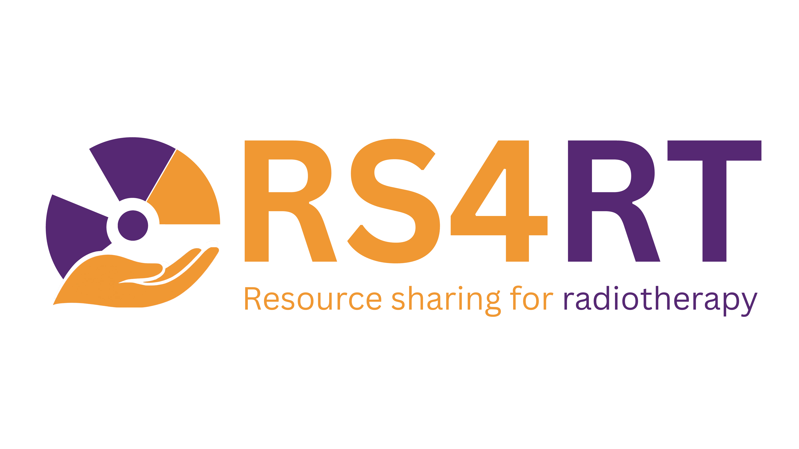

  

<h1 align="center">RS4RT Catalog</h1>

  <em>Resource Sharing for RadioTherapy &mdash; an open catalog of software for radiotherapy research</em>

  <a href="https://miro-uclouvain.github.io/RS4RT_scraper/">Browse the catalog</a> &middot;
  <a href="https://research-software-directory.org/communities/rs4rt/software">RS4RT on the Research Software Directory</a>

---

## About

RS4RT is an independent initiative created after the 2024 ESTRO physics workshop
*Open-Source software and resource sharing in radiotherapy*. Its aim is to make open-source
radiotherapy software easier to find, cite and reuse.

This repository holds the tools behind the catalog: a scraper that discovers candidate
repositories on GitHub and GitLab, a review workflow for curating them by hand, and a
publisher that pushes approved entries to the
[RS4RT community](https://research-software-directory.org/communities/rs4rt/software) on the Research Software Directory.

Maintained by the MIRO laboratory, UCLouvain.

## How it works

1. **Discover** &mdash; the scraper queries GitHub and GitLab for radiotherapy and related
   terms, each discovered repo is assessed against a curated taxonomy of domain terms.
   Depending on the final score, the repository is either kept or discarded.
   The scraper is run every two months and it discards cached repositories.
2. **Review** &mdash; surviving candidates are written to `to_review/` as one folder per
   repository, split across four parts. Reviewers edit the data and metadata of each software
   to ensure relevance and the quality of the information.
3. **Publish** &mdash; approved entries are grouped, formatted and posted to the Research
   Software Directory under the RS4RT community via their API.

Discovery runs on a schedule; review and publication are triggered by hand.

## Catalog

**16** repositories &middot; sources: gitlab &middot; last updated 13 October 2026

| Repository | Platform | Stars | Type | Categories | Summary |
|---|---|---:|---|---|---|
| [radiation-treatment-planning/tcp-ntcp-calculation](https://gitlab.com/radiation-treatment-planning/tcp-ntcp-calculation) | gitlab | 0 | unclear |  | Tumor Control Probability calculation with Poisson Model and Normal Tissue Complication Probability calculation with Poisson relative seriality model. |
| [hdeanclark/DICOMautomaton](https://gitlab.com/hdeanclark/DICOMautomaton) | gitlab | 1 | unclear |  | A multipurpose tool for medical physics. |
| [Cellur-574/opentps](https://gitlab.com/Cellur-574/opentps) | gitlab | 0 | unclear |  | Open source TPS for proton and photon therapy |
| [UM-CDS/projects/image-standardization-and-domain-adaptation/SQLite4Radiomics](https://gitlab.com/UM-CDS/projects/image-standardization-and-domain-adaptation/SQLite4Radiomics) | gitlab | 1 | unclear |  | SQLite4Radiomics is a Conquest DICOM & pyradiomics integration software project |
| [stefvcb/opentps](https://gitlab.com/stefvcb/opentps) | gitlab | 0 | unclear |  | Open source TPS for proton and photon therapy |
| [StellarStorm/opentps](https://gitlab.com/StellarStorm/opentps) | gitlab | 0 | unclear |  | Open source TPS for proton therapy |
| [fpli/opentps](https://gitlab.com/fpli/opentps) | gitlab | 0 | unclear |  | Open source TPS for proton therapy |
| [icmeyer/opentps](https://gitlab.com/icmeyer/opentps) | gitlab | 0 | unclear |  | Open source TPS for proton therapy |
| [UM-CDS/FAIR-compliant_clinical_radiomics_and_DICOM_metadata](https://gitlab.com/UM-CDS/FAIR-compliant_clinical_radiomics_and_DICOM_metadata) | gitlab | 0 | unclear |  | Abstract |
| [opendose/opendose3d](https://gitlab.com/opendose/opendose3d) | gitlab | 19 | unclear |  | This project implements a Slicer3D module aiming for molecular radiotherapy dosimetry |
| [iManu/opendose3d](https://gitlab.com/iManu/opendose3d) | gitlab | 0 | unclear |  | This project implements a Slicer3D module aiming for molecular radiotherapy dosimetry |
| [branchkey/demo-applications/brain-metastases-stereotactic-radiosurgery](https://gitlab.com/branchkey/demo-applications/brain-metastases-stereotactic-radiosurgery) | gitlab | 0 | unclear |  | Included by heuristic/manual filtering. |
| [manchester_qbi/manchester_qbi_public/dce_radiomics_repeatability](https://gitlab.com/manchester_qbi/manchester_qbi_public/dce_radiomics_repeatability) | gitlab | 0 | unclear |  | Follow on from Damien McHugh's work on repeatability of radiomics features of MRI T1W and T2W anatomical images, a study of features computed from DCE-MRI output maps (eg Ktrans an |
| [w654053334/Thyroid_Radiomics](https://gitlab.com/w654053334/Thyroid_Radiomics) | gitlab | 0 | unclear |  | Included by heuristic/manual filtering. |
| [YAAF/dicomviewer](https://gitlab.com/YAAF/dicomviewer) | gitlab | 0 | unclear |  | Included by heuristic/manual filtering. |
| [flywheel-io/scientific-solutions/gears/rtstruct-to-nifti](https://gitlab.com/flywheel-io/scientific-solutions/gears/rtstruct-to-nifti) | gitlab | 0 | unclear |  | Flywheel gear to convert DICOM RTStruct to NIfTI |

---

This file is generated automatically. Edit `src/render_readme.py` rather than `README.md`.
